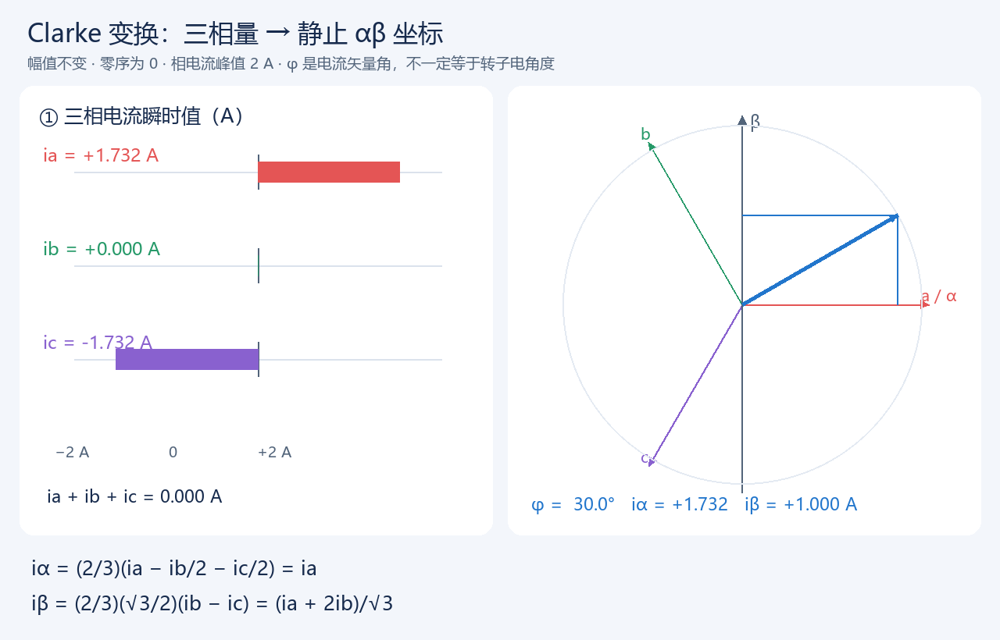
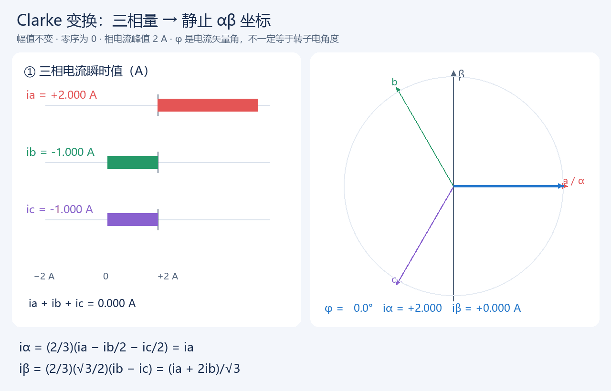
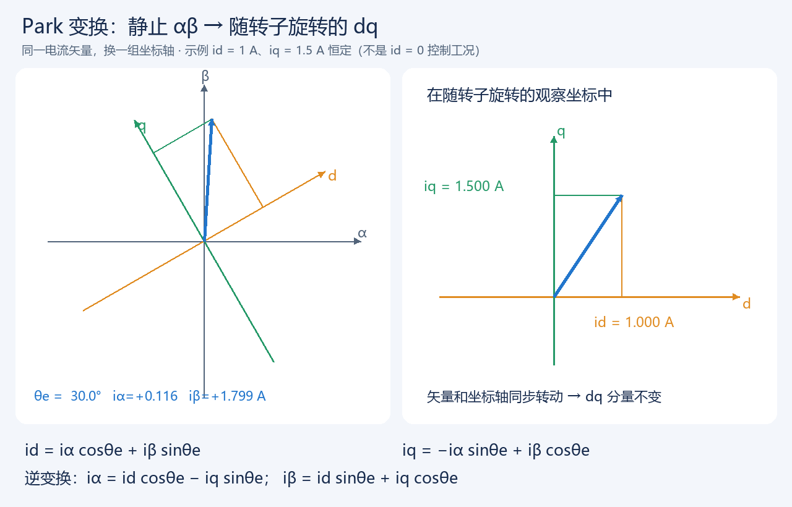
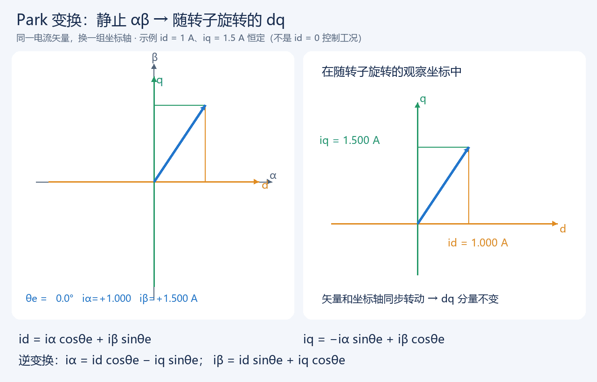

# FOC 电机控制理论笔记

> 目标：建立从三相逆变器、PWM 调制，到电流闭环、速度闭环的完整 FOC（Field Oriented Control，磁场定向控制）知识框架。本文以永磁同步电机（PMSM/BLDC，正弦驱动）为主，许多概念也适用于感应电机。

---

## 1. 先建立全局认识

电机控制器做的事情可以概括为：**测量电机状态 → 计算希望得到的磁场/转矩 → 生成三相桥臂的开关信号**。

对于三相 PMSM，FOC 的核心思路是把三相、时变、耦合的电流，变换到一个随转子一起旋转的 `d-q` 坐标系中：

- `d` 轴与转子永磁体磁链对齐，通常用来控制磁链；
- `q` 轴与 `d` 轴正交，通常主要用来产生转矩；
- 于是交流量在稳态下变成近似直流量，PI 控制器就可以很好地工作。

典型控制链路：

```text
速度给定 ω* ──> 速度 PI ──> iq* ──> q轴电流 PI ──> vq*
                              ↑                       │
                              │                       │
                            iq反馈                    │

磁链/弱磁给定 id* ───────────> d轴电流 PI ──> vd*      │
                              ↑                       │
                            id反馈                    │

ia, ib (或 ia,ib,ic) → Clarke → Park(需电角度 θe) → id, iq
vd*, vq* → 反Park → vα, vβ → SVPWM / SPWM → 三相桥臂 PWM
```

其中，**电角度 `θe` 是否准确**是 FOC 成败的关键之一。

---

## 2. 基础对象：三相逆变器与三相电机

### 2.1 三相全桥逆变器

直流母线电压为 `Vdc`，三相桥臂分别为 A、B、C。每相桥臂由上、下两个功率管组成：

- 上管导通时，相端更接近 `+Vdc`；
- 下管导通时，相端更接近 `0V`（取决于测量参考点）；
- 上、下管绝不能同时导通，否则会发生直通短路；
- 因此 PWM 驱动必须插入**死区时间（dead time）**。

电机绕组通常星形连接且中性点不引出，因此满足：

`ia + ib + ic = 0`

所以只测两相电流即可推算第三相：

`ic = -ia - ib`

### 2.2 机械角与电角度

机械角是转子真实转过的角度；电角度反映电磁场经历的周期。若电机极对数为 `p`：

`θe = p × θm + θoffset`

`ωe = p × ωm`

这里的 `θoffset` 是编码器/霍尔零位和 d 轴真实方向的安装偏置，必须标定。把极数错当成极对数、或者偏置标定错误，都会造成抖动、无力、反转或过流。

---

## 3. 为什么需要坐标变换

三相正弦电流例如：

`ia = Ipk sin(θe)`

`ib = Ipk sin(θe - 120°)`

`ic = Ipk sin(θe + 120°)`

直接控制它们，需要三个相位随时间变化的参考量。FOC 先用 Clarke 变换把 `a-b-c` 三相投影到静止的二维 `α-β` 平面，再用 Park 变换把平面坐标旋转到转子坐标系 `d-q`。

当旋转角正确时，稳态下：

- `id` 是近似恒定量；
- `iq` 是近似恒定量；
- PI 控制器只需调节“直流误差”。

这也是 FOC 比六步换相更平顺、低速性能更好、转矩控制更准确的根本原因。

---

## 4. Clarke 变换：abc → αβ

`α-β` 坐标系固定在定子上。常见的一种幅值不变形式为：

```text
iα = ia
iβ = (ia + 2ib) / √3
```

若已知三相电流，也可写为矩阵形式：

```text
[iα]         [ 1     -1/2     -1/2 ] [ia]
[iβ] = 2/3 · [ 0     √3/2    -√3/2 ] [ib]
                                      [ic]
```

不同资料可能采用不同的归一化系数（幅值不变、功率不变等）。它们本质等价，但**一套工程代码中必须前后一致**，否则电流量级、PI 参数、转矩常数都会对不上。

对电压同理：`va,vb,vc → vα,vβ`。

### 4.1 看图理解 Clarke：不是把三相电流简单相加

本节统一使用**幅值不变**变换：a 轴与 α 轴重合，b 轴位于 +120°，c 轴位于 −120°；β 轴位于 +90°。正角度方向为逆时针。电流单位为 A，数学公式中的三角函数使用弧度（图中为方便阅读显示角度）。



**静态图取电流矢量角 φ=30°。** 左侧条形图表示三个相电流的有符号瞬时值，右侧蓝色箭头表示变换后的同一个电流空间矢量。红、绿、紫三条线是三相的空间轴方向，不是三根随时间转动的物理导线。



**动画怎么看：** 左侧三个电流依次变化，右侧 α、β 轴始终固定，蓝色矢量旋转。虚线方向的投影用细实线表示，读取它在水平、竖直方向的坐标即可得到 iα、iβ。动画只是理想数学演示，播放速度不代表实际电机频率。

如阅读器不自动播放，可[单独打开 Clarke GIF](assets/Clarke_坐标变换.gif)。需要连同 `assets` 文件夹一起保存或移动笔记。

#### 完整公式与零序条件

$$
\begin{bmatrix}i_\alpha\\i_\beta\end{bmatrix}
=\frac{2}{3}
\begin{bmatrix}1&-\frac12&-\frac12\\0&\frac{\sqrt3}{2}&-\frac{\sqrt3}{2}\end{bmatrix}
\begin{bmatrix}i_a\\i_b\\i_c\end{bmatrix}.
$$

展开为：

```text
iα = (2/3) × (ia − ib/2 − ic/2)
iβ = (2/3) × (√3/2) × (ib − ic)
i0 = (ia + ib + ic)/3
```

当 `ia+ib+ic=0` 时，才可简化为 `iα=ia`、`iβ=(ia+2ib)/√3`。若存在零序分量，只有 αβ 两个数不足以恢复完整的三相值，还要保留 i0。

幅值不变逆 Clarke 为：

```text
ia = iα + i0
ib = −iα/2 + (√3/2)iβ + i0
ic = −iα/2 − (√3/2)iβ + i0
```

为什么有 `2/3`？平衡三相沿各自空间轴投影合成后，未经缩放的矢量幅值为相电流峰值的 `3/2`。乘 `2/3` 后，αβ 矢量幅值才等于相电流峰值。**本次已修正原矩阵遗漏的这个系数，不应把无系数矩阵与前面的简化公式混用。**

#### 动画里的三相值如何得到

用 φ 表示电流空间矢量相对 α 轴的角度，不将它与转子电角度 θe 混为一谈。本动画设相电流峰值 I=2 A：

```text
ia = 2 cosφ
ib = 2 cos(φ − 120°)
ic = 2 cos(φ + 120°)
   ↓ Clarke
iα = 2 cosφ
iβ = 2 sinφ
√(iα²+iβ²) = 2 A
```

| φ | ia / A | ib / A | ic / A | iα / A | iβ / A |
|---|---:|---:|---:|---:|---:|
| 0° | 2.000 | −1.000 | −1.000 | 2.000 | 0.000 |
| 30° | 1.732 | 0.000 | −1.732 | 1.732 | 1.000 |
| 90° | 0.000 | 1.732 | −1.732 | 0.000 | 2.000 |

以 30° 为例：`iβ=(1.732+2×0)/√3≈1 A`。逆变换得到 `ib=−1.732/2+√3×1/2≈0 A`，与输入一致。

注意第 3 节采用的是正弦示例，而此动画采用余弦参数化，两者相差 90°。将第 3 节的三相正弦直接代入本节变换，会得到 `iα=Ipk sinθe`、`iβ=−Ipk cosθe`；再使用第 5 节 Park 公式得到 `id=0、iq=−Ipk`。因此不能在不检查相位定义时，把那个示例误认为正 iq 工况。

---

## 5. Park 变换：αβ → dq

Park 变换将静止坐标系旋转 `θe` 到转子同步旋转坐标系：

```text
id =  iα cosθe + iβ sinθe
iq = -iα sinθe + iβ cosθe
```

逆 Park 变换为：

```text
vα = vd cosθe - vq sinθe
vβ = vd sinθe + vq cosθe
```

### 5.1 正负号为什么常让人困惑

不同厂商、开源库与教材会因以下约定不同而出现正负号或相序差异：

- A/B/C 相序；
- 角度增加方向；
- `q` 轴定义在 `d` 轴超前还是滞后 90°；
- 电流采样极性；
- PWM 比较器和功率桥的有效电平。

因此不能只机械照抄公式。正确的系统表现通常是：在 `id*=0`、给小的正 `iq*` 时，电机沿期望正方向平稳产生正转矩，且 `id` 接近 0。若方向错，优先检查相序、传感器方向、角度偏置及 Park 符号约定。

### 5.2 看图理解 Park：矢量没变，观察坐标变了

约定 d 轴相对 α 轴逆时针转过 θe，q 轴在 d 轴逆时针超前 90°。下图左边是站在定子上看，右边是跟着转子一起转的观察结果。绿色 q 轴与橙色 d 轴始终正交。





[单独打开 Park GIF](assets/Park_坐标变换.gif)。动画刻意取 `id=1 A、iq=1.5 A`，方便同时看清两轴投影，**这不是常见的 id=0 控制工况，也不是参数推荐值**。左图矢量和 dq 轴一起转动，iα、iβ 不断变化；右图观察坐标随转子同步转动，矢量坐标保持 `(1,1.5)`。

#### 正变换：将同一个矢量投影到旋转轴

$$
\begin{bmatrix}i_d\\i_q\end{bmatrix}
=\begin{bmatrix}\cos\theta_e&\sin\theta_e\\-\sin\theta_e&\cos\theta_e\end{bmatrix}
\begin{bmatrix}i_\alpha\\i_\beta\end{bmatrix}.
$$

```text
d 轴单位方向 = (cosθe, sinθe)
q 轴单位方向 = (−sinθe, cosθe)
id = (iα, iβ) · d轴单位方向 = iα cosθe + iβ sinθe
iq = (iα, iβ) · q轴单位方向 = −iα sinθe + iβ cosθe
```

这里的点积就是“取沿某个方向的投影”。坐标轴逆时针转 θe，分量转换矩阵相当于转 −θe，因而 q 公式中会出现负号。

#### 逆变换：从 dq 还原 αβ

$$
\begin{bmatrix}i_\alpha\\i_\beta\end{bmatrix}
=\begin{bmatrix}\cos\theta_e&-\sin\theta_e\\\sin\theta_e&\cos\theta_e\end{bmatrix}
\begin{bmatrix}i_d\\i_q\end{bmatrix}.
$$

```text
iα = id cosθe − iq sinθe
iβ = id sinθe + iq cosθe
```

电压使用完全相同的坐标变换矩阵，把 i 换成 v 即可。Park 是正交旋转，因此 `iα²+iβ²=id²+iq²`，不会改变矢量长度。

#### 动画 30° 这一帧的完整计算

由 `id=1 A、iq=1.5 A、θe=30°`，先用逆 Park 生成静止系分量：

```text
cos30° = √3/2 ≈ 0.866025；sin30° = 0.5
iα = 1×0.866025 − 1.5×0.5 = 0.116025 A
iβ = 1×0.5 + 1.5×0.866025 = 1.799038 A
```

再用正 Park 算回去：

```text
id = 0.116025×0.866025 + 1.799038×0.5 ≈ 1.000000 A
iq = −0.116025×0.5 + 1.799038×0.866025 ≈ 1.500000 A
矢量长度 = √(1²+1.5²) ≈ 1.802776 A
```

若 i0=0，再用逆 Clarke 可得 `ia≈0.116025 A、ib=1.500000 A、ic≈−1.616025 A`，三相和为零。这说明三相瞬时电流不是直接等于 id 或 iq，而是同一状态在不同坐标中的表示。

| θe | iα / A | iβ / A | id / A | iq / A |
|---|---:|---:|---:|---:|
| 0° | 1.000000 | 1.500000 | 1.000000 | 1.500000 |
| 30° | 0.116025 | 1.799038 | 1.000000 | 1.500000 |
| 90° | −1.500000 | 1.000000 | 1.000000 | 1.500000 |
| 180° | −1.000000 | −1.500000 | 1.000000 | 1.500000 |

#### 为什么转到 dq 后能成为直流量

一般地，设 `iα=I cosφ、iβ=I sinφ`，代入 Park 得：

```text
id = I cos(φ − θe)
iq = I sin(φ − θe)
```

只有当电流矢量和转子同步旋转、相对角 `φ−θe` 与幅值 I 恒定时，id、iq 才恒定。若角度估计错误、负载瞬变或含有谐波，dq 分量仍会波动，不能理解为“做一次变换就自动滤除了交流”。

在本符号约定下，正 iq、id=0 对应电流矢量沿正 q 轴，即 `φ=θe+90°`，从而 `iα=−I sinθe、iβ=I cosθe`。

#### 快速自检

1. θe=0 时，必须有 `id=iα、iq=iβ`。
2. θe=90° 时，必须有 `id=iβ、iq=−iα`。
3. 正 Park 再逆 Park，应还原输入值（只存在浮点误差）。
4. 零序为零时，逆 Clarke 后应满足 `ia+ib+ic≈0`。
5. 幅值不变不等于功率不变：在零序为零且电压电流采用同一约定时，`p=va·ia+vb·ib+vc·ic=(3/2)(vα·iα+vβ·iβ)=(3/2)(vd·id+vq·iq)`。

> 图片和动画由[本地生成脚本](assets/生成坐标变换图.py)生成，不依赖外部网站。GIF 每轮 72 帧，帧间隔 80 ms，约 5.76 秒循环；静态图对应 30°。数学公式若未被阅读器渲染，可以直接看其下方的纯文本公式。

---

## 6. PMSM 的 d-q 模型与转矩

在常见的 PMSM d-q 模型中：

```text
vd = Rs·id + Ld·did/dt - ωe·Lq·iq
vq = Rs·iq + Lq·diq/dt + ωe·(Ld·id + ψf)
```

含义：

- `Rs`：相电阻；
- `Ld, Lq`：d/q 轴电感；
- `ψf`：永磁体磁链；
- `ωe`：电角速度。

电磁转矩近似为：

```text
Te = 3/2 · p · [ ψf·iq + (Ld - Lq)·id·iq ]
```

对于表贴式 PMSM（SPMSM），往往有 `Ld ≈ Lq`，第二项很小，因此：

`Te ≈ 3/2 · p · ψf · iq`

也就是说，**在 `id=0` 附近，`iq` 基本就是转矩命令**。这就是速度环输出通常设为 `iq*` 的原因。

对于内嵌式 PMSM（IPMSM），`Ld` 和 `Lq` 差别明显，适当的负 `id` 可利用磁阻转矩，实现 MTPA（最大转矩每安培）控制。

---

## 7. FOC 的控制环路

### 7.1 电流环：最快、最核心的环

每个 PWM 周期或每几个 PWM 周期执行一次：

```text
ed = id* - id
eq = iq* - iq

vd = PI_d(ed)
vq = PI_q(eq)
```

工程上常加交叉耦合补偿（前馈解耦）：

```text
vd_cmd = PI_d(ed) - ωe·Lq·iq
vq_cmd = PI_q(eq) + ωe·(Ld·id + ψf)
```

优点是高速时 d/q 两轴相互影响较小，动态更好。低速、小功率系统即使暂不加解耦也可能正常运行。

电流 PI 输出必须受电压矢量能力限制。若 `vd² + vq²` 超过母线能提供的范围，需限幅并做积分抗饱和（anti-windup），否则积分项积累会引起恢复慢、过冲大。

### 7.2 速度环：输出转矩需求

速度环频率通常比电流环低，例如电流环 10~40 kHz，速度环 0.5~5 kHz（具体取决于系统）。

```text
eω = ω* - ω
iq* = PI_speed(eω)
```

常见配置：

- 正常基速以下：`id* = 0`；
- 限制 `iq*` 在允许电流范围内；
- 速度给定增加斜坡，避免瞬间大电流；
- 速度反馈可由编码器差分、霍尔估算或观测器得到，并应适当滤波。

### 7.3 位置环（伺服场景）

位置环最慢：

`位置误差 → 位置控制器 → 速度给定 → 速度环 → iq*`

一般遵循“内环快、外环慢”的带宽层级，方便稳定性设计。

---

## 8. SPWM：正弦脉宽调制

### 8.1 基本原理

SPWM（Sinusoidal PWM）让每相的正弦参考波与高频三角载波比较：

- 参考波大于载波时，上管导通；
- 否则下管导通；
- 三相参考正弦彼此相差 120°。

调制度常记为 `m`。在线性调制区，输出基波电压随 `m` 增加而增加。

### 8.2 特点

- 概念直观，易于实现；
- 调制波形平滑；
- 对直流母线电压的利用率低于 SVPWM；
- 在同样母线电压下，较早触及电压上限。

在数字控制中，SPWM 也可理解为根据三相电压参考直接计算每相占空比。若使用中心对齐 PWM，谐波与采样同步通常更容易处理。

---

## 9. SVPWM：空间矢量脉宽调制

### 9.1 空间矢量观点

三相两电平逆变器有 8 个开关状态：

- 6 个有效矢量：在 `α-β` 平面上形成正六边形；
- 2 个零矢量：`000` 和 `111`，矢量位于原点。

SVPWM 的目标是在一个 PWM 周期 `Ts` 内，用相邻两个有效矢量及零矢量的作用时间，合成期望电压矢量 `Vref`：

```text
Vref · Ts = Vn·T1 + Vn+1·T2 + V0·T0
T0 = Ts - T1 - T2
```

其中 `Vref` 所在的 60° 区域称为扇区（Sector 1~6）。

### 9.2 SVPWM 的主要优势

- 直流母线利用率比传统 SPWM 高约 15%；
- 同样的 `Vdc` 下可得到更大的基波相电压；
- 开关序列可设计为对称，谐波特性较好；
- 很适合 FOC 中的 `vα,vβ` 电压矢量输出。

### 9.3 工程上常用的“零序注入”实现

不一定要显式计算扇区和 `T1/T2`。一种非常实用的等价实现是：

1. 由逆 Clarke 得到三相参考 `va,vb,vc`；
2. 找到 `vmax = max(va,vb,vc)`，`vmin = min(va,vb,vc)`；
3. 注入公共模式（零序）分量：

```text
voffset = -(vmax + vmin) / 2
va' = va + voffset
vb' = vb + voffset
vc' = vc + voffset
```

4. 映射为占空比，例如：

```text
da = 0.5 + va' / Vdc
db = 0.5 + vb' / Vdc
dc = 0.5 + vc' / Vdc
```

之后再进行 `[0,1]` 限幅及死区相关处理。这个方法本质上就是连续 SVPWM 的一种实现形式，代码往往更简洁。

### 9.4 SPWM 与 SVPWM 对比

| 项目 | SPWM | SVPWM |
|---|---|---|
| 思想 | 正弦波与三角载波比较 | 合成目标空间电压矢量 |
| 母线利用率 | 较低 | 更高，约高 15% |
| 实现难度 | 入门简单 | 略复杂，但零序注入法很实用 |
| FOC 适配性 | 可以使用 | 工业 FOC 中非常常见 |
| 过调制 | 更早进入 | 电压线性范围更大 |

注意：SVPWM 并不自动让电流控制“更准”。它的核心收益是更充分利用直流母线电压；电流环效果还取决于角度、采样、PI 参数、电机参数和时序。

---

## 10. 从 vd/vq 到 PWM：完整快速流程

以下流程是典型电流环 ISR（中断服务程序）的骨架：

```text
1. 读取 ADC：ia, ib, Vdc（必要时温度等）
2. 电流零漂校正，得到真实 ia、ib；计算 ic = -ia-ib
3. 读取/估算转子电角度 θe 与电角速度 ωe
4. Clarke：ia, ib → iα, iβ
5. Park：iα, iβ, θe → id, iq
6. 计算电流误差：id*-id、iq*-iq
7. d/q 电流 PI（可加入解耦、反电动势前馈）→ vd*, vq*
8. 电压矢量限幅与 PI 抗积分饱和
9. 逆 Park：vd*,vq* → vα,vβ
10. SVPWM / SPWM：vα,vβ → da,db,dc
11. 写 PWM 比较寄存器；在安全的采样窗口触发下一次 ADC
```

---

## 11. 电流采样：理论必须落到时序

### 11.1 两电阻、三电阻与单电阻

- **三电阻采样**：每相各一个分流电阻，重建电流方便，成本/损耗较高；
- **两电阻采样**：常见方案，利用 `ia+ib+ic=0` 推算第三相；
- **单母线电阻采样**：成本低，但必须在特定开关状态下采样，低占空比和扇区切换时更复杂。

### 11.2 为什么采样时刻重要

PWM 切换瞬间存在开关尖峰、二极管反向恢复、死区、电流纹波和 ADC 建立时间。若恰好在切换沿附近采样，读数噪声会很大，电流环可能震荡。

通常采用中心对齐 PWM，并把 ADC 触发放在开关状态稳定、远离边沿的位置。具体时刻还要考虑：

- 电流采样放大器的建立时间；
- ADC 采样时间与转换延迟；
- PWM 死区；
- MCU 从 ADC 数据就绪到更新占空比的计算延迟。

### 11.3 电流偏置校准

上电且 PWM 未驱动时，理论电流为零。对 ADC 多次平均，保存每路零电流偏置：

`i_measured = gain × (adc_raw - offset)`

这是最基础但极重要的步骤。偏置不准会使 `id`、`iq` 长期带偏，造成发热、噪音和零转矩时仍有电流。

---

## 12. 角度获取：有感与无感

### 12.1 有感 FOC

常用传感器：

- 增量式编码器；
- 绝对值编码器；
- 旋转变压器；
- 三个霍尔传感器。

高分辨率编码器最适合低速/零速高性能控制。霍尔通常每电周期只有 6 个状态，低速角度分辨率较粗，常需插值或 PLL 平滑。

### 12.2 无感 FOC

无感控制用电压、电流和电机模型估算转子角度。常见方法：

- 反电动势观测器；
- PLL（锁相环）；
- SMO（滑模观测器）；
- 磁链观测器；
- 高频注入（适用于低速/零速，尤其 IPMSM）。

反电动势幅值与速度相关，因此普通反电动势无感方案在极低速或静止时较困难，往往需要开环起动、对准流程或高频注入辅助。

---

## 13. 对准（Alignment）与初始起动

编码器或无感估算器刚上电时，必须建立“软件角度”与转子 d 轴的对应关系。

常见有感对准方法：

1. 以有限电流施加固定方向的 d 轴电压/电流；
2. 转子被吸到已知电角度；
3. 读取传感器机械角，计算或记录偏置；
4. 释放后以该偏置进行闭环控制。

注意：对准电流过大可能撞击机械限位或造成发热；过小则可能无法克服负载和摩擦。带负载系统还需要考虑安全动作与可重复性。

---

## 14. 弱磁、MTPA 与电压/电流限制

### 14.1 为什么高速需要弱磁

电机速度升高后，反电动势随速度增加。可用电压受母线电压限制，最终 `vq` 没有余量继续维持电流。此时通过给负 `id` 抵消部分永磁磁链，可降低反电动势，从而扩展转速范围，这称为**弱磁控制**。

代价是：

- 需要更多电流容量；
- 转矩能力可能下降；
- 负 `id` 过大可能导致永磁体退磁风险；
- 控制与限幅策略更复杂。

### 14.2 MTPA

对 IPMSM，在给定电流幅值下选择合适的 `id/iq` 组合，使转矩最大，称为 MTPA。它能减少铜耗、提高中低速效率。SPMSM 常常直接使用 `id*=0` 即可。

### 14.3 限制的优先级

真实系统至少有三类边界：

- 电流限制：保护功率器件和绕组；
- 电压限制：受 `Vdc`、调制方式限制；
- 速度/位置限制：保护机械系统。

控制器必须明确在饱和时保留什么目标，例如优先限幅 `iq` 保证不超流，或在高速时分配电压给弱磁与转矩需求。

---

## 15. PI 参数整定的实用顺序

1. **先确认硬件与测量**：相序正确、电流零偏准确、角度方向正确、母线电压读数可信；
2. 不接或减小机械负载，先做开环/对准验证；
3. 只闭合电流环，给很小的 `id*`、`iq*` 阶跃，观察跟踪、噪声和过冲；
4. 调好电流环后再闭合速度环；
5. 最后再引入位置环、弱磁、MTPA 等功能。

经验原则：

- 电流环带宽最高；
- 速度环带宽显著低于电流环（常取低一个数量级左右作为起点）；
- 采样噪声大时，单纯提高 PI 增益通常会更糟；
- 任何积分器都应有输出限制和抗饱和设计。

电流环对象近似为 `1/(Ls + R)`。在已知 `L、R` 和目标电流环带宽 `ωc` 时，可用近似初值：

`Kp ≈ L × ωc`

`Ki ≈ R × ωc`

但离散化方式、采样延迟、电流标定单位、PWM 频率都会改变最终数值，因此这只是起点，必须通过实测调试。

---

## 16. 常见问题与排查方向

| 现象 | 优先检查 |
|---|---|
| 一给电流就剧烈抖动/尖叫 | 电角度偏置、相序、编码器方向、Park 符号、电流采样极性 |
| 电机能转但无力、效率低 | `id` 是否明显非零、角度误差、母线电压不足、电流限幅 |
| 低速很顺，高速失速 | 电压饱和、弱磁不足、反电动势、采样/PWM 时序、速度估算 |
| 静止时发热 | 电流偏置、`id/iq` 零点、积分器残留、死区畸变 |
| 电流波形很毛糙 | 采样点靠近开关沿、ADC 建立时间、布局/接地、死区补偿 |
| 正负转表现不对称 | 相电流偏置、死区效应、摩擦/负载、角度表方向或偏置 |
| 速度环大幅超调 | 外环过快、积分过大、`iq` 限幅与 anti-windup 不当 |

调试时建议记录或通过示波器/上位机观察：`ia, ib, id, iq, id*, iq*, vd, vq, θe, ωe, Vdc, da/db/dc`。只看最终转速往往很难定位问题。

---

## 17. 死区效应与补偿

为防止上下桥臂直通，PWM 要插入死区。死区会使实际平均相电压与理想占空比相关，并且误差与相电流方向有关。低速时反电动势很小，死区误差所占比例变大，可能导致：

- 电流过零畸变；
- 转矩脉动和啸叫；
- 低速爬行不平稳。

常见补偿思想是根据相电流正负，对每相占空比增加或减少一个与死区对应的小量。补偿要谨慎：电流过零附近容易因噪声频繁切换，可加入阈值或滞回。

---

## 18. FOC、六步换相与 BLDC 的关系

“BLDC”在工程中有时指梯形反电动势电机与六步方波换相，有时也泛指永磁无刷电机。更严格地说：

- **六步换相**：根据霍尔状态每 60 电角度切换导通相，简单、成本低，但转矩纹波和噪声较明显；
- **正弦驱动 FOC**：连续调节定子电流矢量，运行更平滑，控制精度和效率潜力更高；
- PMSM 是更贴近 FOC 模型的称呼，反电动势接近正弦时效果通常最好。

同一台电机能否从六步改为 FOC，取决于反电动势、位置传感器分辨率、驱动硬件、控制器算力和标定质量。

---

## 19. 推荐学习路径

建议不要只按名词孤立记忆，而是按信号流学习：

1. 三相逆变器、PWM、死区、母线电压；
2. 三相正弦量与相序；
3. Clarke / Park / 逆变换，能手算一个简单例子；
4. PMSM 的 `id/iq` 与转矩关系；
5. 电流 PI、限幅与 anti-windup；
6. SPWM 和 SVPWM，理解它们都在把“电压指令”变成“占空比”；
7. ADC 采样同步、零偏校正、角度对准；
8. 速度环、弱磁、无感观测器等进阶主题。

一个很有效的练习是：给定某个 `θe、id、iq`，先反 Park 得到 `iα/iβ`，再换成三相电流；反过来再算回来。把坐标变换真正算通以后，FOC 的大部分代码结构就不神秘了。

---

## 20. 最小伪代码示例

```c
// 以固定频率 PWM 中断执行。比例系数、限幅和硬件寄存器细节省略。
void foc_current_isr(void)
{
    read_phase_currents(&ia, &ib);
    ic = -ia - ib;
    theta_e = get_electrical_angle();

    // Clarke
    i_alpha = ia;
    i_beta  = (ia + 2.0f * ib) * INV_SQRT3;

    // Park
    sincos(theta_e, &s, &c);
    id =  i_alpha * c + i_beta * s;
    iq = -i_alpha * s + i_beta * c;

    // Current PI (实际工程应加入限幅与 anti-windup)
    vd = pi_d(id_ref - id);
    vq = pi_q(iq_ref - iq);

    limit_voltage_vector(&vd, &vq, vbus);

    // Inverse Park
    v_alpha = vd * c - vq * s;
    v_beta  = vd * s + vq * c;

    // SVPWM（也可使用等价的零序注入法）
    svpwm(v_alpha, v_beta, vbus, &duty_a, &duty_b, &duty_c);
    set_pwm_duty(duty_a, duty_b, duty_c);
}
```

---

## 21. 一页速记

- FOC：把三相交流电流变到随转子旋转的 `d-q` 坐标系后做闭环控制。
- `id`：主要影响磁链；表贴 PMSM 常设为 0。
- `iq`：主要产生转矩；速度环通常输出 `iq*`。
- Clarke：`abc → αβ`，静止二维坐标。
- Park：`αβ → dq`，需要正确电角度。
- 逆 Park + SVPWM：把 `vd/vq` 最终变成三相桥臂占空比。
- SPWM：直观、易学；SVPWM：母线利用率更高，FOC 更常用。
- FOC 实际能否稳定，离不开准确的角度、可靠的电流采样、正确的相序、合适的 PI 与安全限幅。

---

## 22. 后续建议：结合代码学习时要找的模块

当你开始阅读某个 MCU 工程（STM32、TI C2000、ESP32 等）时，可按以下名称寻找对应模块：

- `current_sense` / `adc`：电流采样、零偏校正、ADC 同步；
- `encoder` / `hall` / `observer`：角度、速度估算；
- `clarke`、`park`、`ipark`：坐标变换；
- `pid` / `pi`：电流环、速度环；
- `svpwm` / `pwm`：占空比计算与寄存器更新；
- `alignment`：上电对准与角度偏置；
- `protection`：过流、过压、欠压、过温、失速等保护。

如果能把一次 PWM 中断里这些模块的数据流画出来，就已经真正掌握了一个 FOC 工程的骨架。
